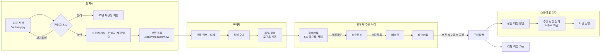

# 곳간 GOTGAN — 멀티 스토어 오픈마켓 목업

> 작은 가게들의 큰 장터.
> 판매자가 **입점 신청 → 관리자 승인 → 자기 스토어 운영**을 하고, 구매자는 여러 스토어의 상품을 한 번에 구매하며, 운영자는 스토어별 판매대금을 **수수료를 제외하고 정산**하는 스마트스토어형 E-커머스의 **화면 목업**입니다.

- 실제 API / DB 연동 없음 → **모든 데이터는 `src/data/*.js` 에 하드코딩**
- 화면 이동, 상태 변화(장바구니 담기, 발주확인, 입점 승인 등)는 **프론트 상태로만 흉내** (새로고침 시 초기화)
- 화면 좌측 하단 **`MOCK 화면 목록`** 버튼으로 46개 화면(42개 라우트) 어디로든 바로 이동 가능
- 범위 기준: 곳간 가이드라인 개정 8절(서비스 9개 + Keycloak, MoSCoW). 찜 · 쿠폰 · 비회원 구매 · 회원 신고는 제외 (5절 "제외한 기능")
- 배포 페이지 https://mockup-page-sable.vercel.app/ (가이드 문서와 함께 보기: https://gotganguide.vercel.app/)

---

## 1. 실행 방법

```bash
npm install
npm run dev        # http://localhost:5173
```

| 스크립트 | 설명 |
| --- | --- |
| `npm run dev` | 개발 서버 (Vite, Node.js 18+) |
| `npm run build` / `npm run preview` | 프로덕션 빌드 / 빌드 결과 미리보기 |
| `npm run fetch:images` | 목업 이미지 재수집 (이미 있는 파일은 건너뜀) |

### 사용자별 진입 경로

| 역할 | 시작 URL | 목업 계정 |
| --- | --- | --- |
| 구매자 | `/` | 김서연 (GOLD 회원) |
| 판매자 | `/seller` | 오롯이 리넨 · 한지우 대표 |
| 스토어 관리자 | `/admin` | 곳간 운영팀 |

로그인 화면(`/login`)에서 구매회원 / 판매자 / 운영자 탭을 고르고 로그인 버튼을 누르면 각 영역으로 이동합니다. (인증 없음 · 실제로는 자체 로그인 폼 → user-service → Keycloak, 역할 BUYER / SELLER / ADMIN, 소셜 로그인 없음)

---

## 2. 기술 스택

| 구분 | 사용 | 비고 |
| --- | --- | --- |
| UI | React 18 | 함수형 컴포넌트 + hooks |
| 라우팅 | react-router-dom 6 | 중첩 라우트 + 레이아웃(Outlet) |
| 스타일 | Tailwind CSS 4 (`@tailwindcss/vite`) | 디자인 토큰은 `src/index.css` 의 `@theme` |
| 빌드/개발서버 | Vite 6 (Node.js) | |
| 아이콘 | lucide-react | 선 굵기 1.6~1.8 로 통일 |
| 폰트 | Pretendard (본문), IBM Plex Mono (숫자·주문번호) | CDN |
| 차트 | 직접 그린 SVG (`BarChart`, `HBars`, `Spark`) | 차트 라이브러리 미사용 |

---

## 3. 폴더 구조

```
expage/
├─ public/images/          # 목업 이미지 (Unsplash, 141장) + CREDITS.txt
│  ├─ p/                   #   상품 이미지  p{상품ID}-{1..3}.jpg
│  ├─ banner/ store/ avatar/
├─ scripts/fetch-images.mjs  # 이미지 수집 스크립트
├─ src/
│  ├─ data/                # ★ 하드코딩 목업 데이터
│  │  ├─ catalog.js        #   카테고리(상위/하위 · 수수료율) · 스토어 9 · 상품 38
│  │  ├─ people.js         #   회원 14 · 회원등급(NORMAL/SILVER/GOLD) · 배송지 · 입점신청 5
│  │  ├─ reviews.js        #   리뷰(시드 랜덤 생성) · 검토 대상 리뷰 · Q&A
│  │  ├─ orders.js         #   주문상태 · 클레임 유형 · 내 주문 · 판매자 주문 · 포인트 계산 · 정산 · 일별 매출
│  │  ├─ points.js         #   포인트 내역(적립/사용/회수/환원) · 잔액
│  │  └─ faq.js            #   고객센터 FAQ (정적 데이터)
│  ├─ lib/
│  │  ├─ format.js         #   금액/날짜 포맷, 시드 난수, 기준일(2026-10-01)
│  │  └─ store.jsx         #   전역 상태: 장바구니 · 토스트
│  ├─ components/
│  │  ├─ ui.jsx            #   Stars, Pill/StatusPill, GradeBadge, Price, Modal, Kpi, BarChart, Segments, KV …
│  │  ├─ ProductCard.jsx
│  │  └─ MockNav.jsx       #   목업 화면 바로가기 패널
│  ├─ layouts/
│  │  ├─ ShopLayout.jsx    #   쇼핑몰 헤더/메가메뉴/푸터
│  │  └─ ConsoleLayout.jsx #   판매자센터·관리자 공용 콘솔 (상단바 + 사이드메뉴 + 알림)
│  ├─ pages/
│  │  ├─ shop/             #   메인, 목록, 상세, 스토어, 장바구니, 결제, 로그인, 고객센터, 입점신청
│  │  ├─ mypage/           #   주문/배송, 취소·반품·교환, 리뷰, 상품문의, 포인트, 회원정보, 배송지
│  │  ├─ seller/           #   대시보드, 상품 CRUD, 주문, 클레임, 리뷰, 문의, 정산, 스토어설정
│  │  └─ admin/            #   대시보드, 입점심사, 스토어, 정산, 회원, 리뷰, 카테고리
│  └─ App.jsx              # 전체 라우트 정의
└─ README.md
```

---

## 4. 전체 비즈니스 플로우



### 4-1. 주문 상태 (상품주문 단위)

한 번의 결제에 여러 스토어 상품이 섞일 수 있으므로, **주문번호(결제 단위)** 아래에 **상품주문번호(스토어·상품 단위)** 를 두고 **상태는 상품주문 단위로 관리**합니다. (스마트스토어 방식)

| 상태 | 누가 바꾸나 | 다음 상태 | 구매자 가능 액션 |
| --- | --- | --- | --- |
| 결제완료 | 시스템 | 배송준비 (판매자 **발주확인**) | 취소 신청 (즉시 취소) |
| 배송준비 | 판매자 | 배송중 (판매자 **송장등록**) | 취소 요청 (판매자 승인 필요) |
| 배송중 | 판매자 (status) | 배송완료 | 배송조회 |
| 배송완료 | 판매자 (status) | 구매확정 | 구매확정 / 반품 요청 / 교환 요청 |
| 구매확정 | 구매자 or **7일 후 자동** | — | 리뷰 작성 (30일 이내) |
| 취소요청 / 반품요청 / 교환요청 | 구매자 | 취소완료 / 반품완료 / 교환완료(재배송) | 요청 철회 |

- 취소 · 반품 완료 시: 결제 부분 취소(payment) → 재고 복원(product) → 그 상품주문분 **사용 포인트 환원 · 적립 포인트 회수**(user)
- 교환: 결제 · 재고 변동 없이 order 안 상태만 변경(재배송)
- 판매자가 거부하면 거부 사유가 구매자 클레임 내역에 표시

### 4-2. 정산 규칙 (핵심)

```
지급액 = 구매확정 매출 − 환불 − 판매수수료(카테고리별) − 결제수수료(2.2%)
```

| 항목 | 규칙 |
| --- | --- |
| 정산 기준일 | **구매확정일** (배송완료가 아니라 확정 시점 → 반품 리스크 제거) |
| 정산 주기 | 주 1회 · 월~일 구매확정분 → **다음 주 목요일 지급** |
| 판매수수료 | 카테고리별 (아래 표) · 스토어별 개별 조정 가능 · 신규 입점 3개월 50% 지원 |
| 결제수수료 | PG 수수료 2.2% 일괄 |
| 지급 보류 | 클레임 미처리, 스토어 휴면/정지 시 해당 주차 보류 → 해소 후 지급 |
| 수수료 변경 | 판매자 공지 후 7일 뒤 적용 (관리자 > 카테고리·수수료에서 "변경 예약") |

| 카테고리 | 판매수수료 | 합계(결제수수료 포함) | 추가 입점 서류 |
| --- | --- | --- | --- |
| 패션의류 | 11% | 13.2% | — |
| 신발·가방 | 11% | 13.2% | — |
| 리빙·인테리어 | 9% | 11.2% | — |
| 식품 | 7% | 9.2% | 영업신고증 / 농업경영체 |
| 뷰티 | 10% | 12.2% | 화장품 책임판매업 등록필증 |
| 디지털·가전 | 6% | 8.2% | KC 인증서 |

### 4-3. 입점 심사

`심사대기 → (보완요청) → 승인 / 반려`

- 제출 서류: 사업자등록증, 통신판매업 신고증, 정산계좌 통장사본, 대표 상품 사진 (+ 카테고리별 인증서)
- 관리자 체크리스트(국세청 사업자 상태, 통판 신고, 중복 입점, 카테고리 적합성, 인증서)를 **모두 체크해야 승인 버튼 활성화**
- 승인 시: 스토어 생성(운영중) → 판매자센터 계정 발급 → 안내 메일/알림톡 → 메인 신규 스토어 2주 노출
- 보완요청 후 7일 내 미보완 시 자동 반려 / 반려 후 30일 재신청 제한

### 4-4. 스토어 상태

| 상태 | 쇼핑몰 노출 | 주문 처리 | 정산 |
| --- | --- | --- | --- |
| 운영중 | O | O | 정상 |
| 휴면 (판매자 신청) | X (스토어·상품 숨김) | 진행 중 주문만 | 클레임 해소 후 지급 |
| 정지 (관리자 제재) | X | 제한 | 지급보류 |

> 목업 데이터에서 **볕드는집(s5)** 이 휴면 상태 예시입니다. 쇼핑몰에서 상품이 사라지고, `/store/s5` 접근 시 휴면 안내가, 관리자 정산에서는 지급보류가 표시됩니다.

### 4-5. 리뷰 · 상품문의 (review-service)

- 작성 조건: **구매확정된 상품주문 1건당 1개**, 확정 후 30일 이내 · **별점(1~5) + 사진**
- 작성 자격은 `OrderItemConfirmed` 이벤트로 review가 자기 DB에 저장 → order 장애와 무관하게 작성 가능
- 패션·신발 카테고리는 **사이즈 체감(작아요/정사이즈/커요)** 수집 → 상세에서 분포 표시
- 판매자는 **답글만 가능, 삭제 불가** → 운영 정책 위반 리뷰는 관리자가 **블라인드 / 정상 노출** 처리
- 상품문의(Q&A): 상품 상세 Q&A 탭에서 작성(비밀글 가능) → 판매자센터 `상품 문의`에서 답변 → 마이페이지 `상품 문의`에서 확인

### 4-6. 배송비

- **스토어 단위 묶음배송**: 같은 스토어 상품끼리 배송비 1회, 스토어별 무료배송 기준 적용
- 장바구니에서 스토어별로 그룹핑하고 "○○원 더 담으면 무료배송" 안내

### 4-7. 포인트 · 회원등급 (user-service, Should)

```
실결제금액 = 상품금액(할인 반영) + 배송비 − 사용 포인트
적립 포인트 = 실결제금액 × 5%   (OrderPaid 이벤트 후 비동기 적립)
```

| 항목 | 규칙 |
| --- | --- |
| 사용 | 결제 화면 `포인트 사용` 블록에서 입력 또는 **전액 사용** (1P = 1원, 보유 포인트 · 결제금액 한도) |
| 적립 | 결제 시 **실결제금액(포인트 사용분 제외)의 5%**, 다음 결제부터 사용 |
| 배분 | 사용 · 적립 포인트는 **상품주문 단위로 금액 비율 배분**해 기록 |
| 취소 · 반품 | 그 상품주문분 **사용 포인트 환원 + 적립 포인트 회수** (교환은 변동 없음) |
| 내역 구분 | `적립` · `사용` · `회수` · `환원` (마이페이지 > 포인트) |
| 회원등급 | 누적 구매확정 금액 기준 **NORMAL / SILVER(30만원) / GOLD(80만원)** · 혜택은 표시만, 적립률은 모든 등급 5% |

### 4-8. 고객센터

- `/help` = **FAQ(프론트 정적 데이터 `src/data/faq.js`)** + 상품문의 안내(상품 상세 Q&A 탭 · 마이페이지 상품 문의 링크) + 취소/반품/교환 바로가기
- 고객센터용 별도 서비스 · 1:1 문의 · 회원 신고는 없음

---

## 5. 요구사항 외에 추가한 기능

| 영역 | 추가 내용 | 이유 |
| --- | --- | --- |
| 공통 | **구매확정 단계 + 자동 확정(7일)** | 정산 시점을 명확히 하기 위한 오픈마켓 표준 |
| 공통 | 취소 · 반품 · 교환 클레임 플로우 (구매자 유형 선택 · 사유 → 판매자 승인/거부 · 재배송) | 실제 운영에서 가장 많은 CS |
| 공통 | 상품 Q&A (비밀글 포함) | 판매자 응대 지표 |
| 구매자 | 스토어별 묶음배송 · 무료배송 임계값 안내 | 멀티 스토어 장바구니의 핵심 UX |
| 구매자 | **포인트 사용 · 5% 적립 · 환원/회수 내역**, 회원등급 뱃지 | 결제 화면 금액 구성 · 클레임 환불 계산 |
| 구매자 | 스토어 홈 + 알림받기(관심고객) | 스마트스토어 '내 스토어' 개념 |
| 구매자 | 품절 상품 재입고 알림 | 품절 상태 화면 |
| 판매자 | 조합형 옵션 + 조합별 재고 테이블, **예상 정산액 계산기** | 상품 등록 시 수수료 인지 |
| 판매자 | 상위/하위 카테고리 선택(운영자 등록 목록에서만) | 카테고리별 수수료 · 검색 일관성 |
| 판매자 | 송장 일괄입력 모달, 발송지연 안내 | 주문 대량 처리 |
| 판매자 | 자주 쓰는 답글 | 리뷰 관리 효율 |
| 판매자 | 휴면 신청 | 스토어 상태 관리 |
| 관리자 | 입점 심사 **체크리스트 / 보완요청 / 반려 사유** | 심사 프로세스 표준화 |
| 관리자 | 카테고리 트리(상위/하위) 관리 · 카테고리별 수수료 · 스토어별 개별 수수료 | 수수료 정책 |
| 관리자 | 정산 지급 실행 / **지급보류(사유)** | 정산 리스크 관리 |
| 관리자 | 리뷰 블라인드 관리, 회원 이용정지 · 포인트/등급 조회 | 콘텐츠 · 회원 관리 |
| 관리자 | 상품 강제 판매중지, 스토어 페널티 점수 | 판매자 제재 |

### 제외한 기능 (Won't)

| 기능 | 처리 |
| --- | --- |
| **찜(위시리스트)** | 라우트 `/mypage/wishlist`, 상품 카드 · 상세의 하트 버튼, 찜 카운터 · 데이터 삭제 |
| **쿠폰** | 라우트 `/mypage/coupons`, 결제 · 상품 상세 · 주문 상세의 쿠폰 UI, 쿠폰 데이터 삭제 → 금액은 쿠폰 할인 없이 재계산 |
| **비회원 구매** | 화면 없음 (로그인 후 주문) |
| **회원 신고** | 화면 없음 (상품 상세 · 판매자 리뷰의 신고 버튼과 신고 모달 삭제) |
| 소셜 로그인 | 로그인 화면의 간편 로그인 버튼 삭제 (자체 로그인 폼 → Keycloak) |

---

## 6. 화면 목록 (42개 라우트 · MOCK 바로가기 46개)

### 구매자 · 쇼핑몰
| 화면 | 경로 | 주요 요소 |
| --- | --- | --- |
| 메인 | `/` | 배너 캐러셀, 카테고리, 카테고리별 랭킹, 이번 주의 가게, 신상, 포토리뷰, 입점 CTA |
| 상품 목록 | `/products?cat=&sub=&q=&sort=&tag=` | 카테고리/가격/혜택 필터, 6종 정렬, 모바일 필터 드로어 |
| 상품 상세 | `/products/:id` | 갤러리, 연동 옵션 선택, 배송정보, 적립 예정 포인트, 별점 분포, **사이즈 체감**, 포토리뷰, 리뷰 필터/정렬/도움돼요, Q&A, 배송·교환·반품, 스토어 카드 |
| 스토어 목록 / 홈 | `/stores`, `/store/:id` | 스토어 소개, 알림받기, 스토어 내 카테고리 탭 |
| 장바구니 | `/cart` | 스토어별 그룹, 수량, 선택삭제, 무료배송까지 남은 금액, 5% 적립 예정 |
| 주문/결제 | `/checkout` | 배송지 선택, 주문상품, **포인트 사용(보유 · 입력 · 전액 사용) → 실결제금액 · 5% 적립 예정**, 결제수단, 약관 동의 |
| 주문 완료 | `/order/complete` | 주문번호, 사용 포인트, 실결제금액, 적립 포인트 |
| 로그인 / 회원가입 | `/login`, `/signup` | 자체 폼(이메일 · 비밀번호), 역할 탭(구매회원 / 판매자 / 운영자) |
| 고객센터 | `/help` | FAQ 검색 · 분류 필터, 상품문의 안내, 취소/반품/교환 바로가기 |
| 입점 신청 | `/seller/apply` | 4단계 폼 (판매자 정보 → 스토어·상품 → 서류 → 정산·약관) → 접수 타임라인 |

### 구매자 · 마이페이지
| 화면 | 경로 |
| --- | --- |
| 상단 요약 (회원등급 뱃지 · 다음 등급까지 금액, 포인트 · 작성 가능 리뷰 · 진행 중 클레임) | 마이페이지 공통 |
| 주문 · 배송 (상태별 카운트, 상태별 액션 버튼) | `/mypage/orders` |
| 주문 상세 (배송 추적 타임라인, 결제정보: 상품금액 · 배송비 · 포인트 사용 · 실결제금액 · 적립 포인트) | `/mypage/orders/:id` |
| 취소 · 반품 · 교환 신청 (유형 선택 · 사유 · 배송비 부담 · 결제수단 환불액 · 포인트 환원/회수) | `/mypage/claim/:lineId?type=취소\|반품\|교환` |
| 취소 · 반품 · 교환 내역 (유형 필터, 상세 펼침 = 환불 · 포인트 환원/회수) | `/mypage/claims` |
| 리뷰 관리 (작성 가능 / 작성한 리뷰, 별점 · 사이즈 · 사진 작성 모달) | `/mypage/reviews` |
| 상품 문의 | `/mypage/qna` |
| **포인트** (보유 포인트, 누적 적립/사용/회수/환원, 내역 표 · 구분 필터) | `/mypage/points` |
| 회원정보 (회원등급 표) · 배송지 | `/mypage/profile`, `/mypage/addresses` |

### 판매자센터 (`/seller`)
| 화면 | 경로 |
| --- | --- |
| 대시보드 (할 일, KPI, 30일 매출 차트, 인기상품, 재고부족, 새 리뷰, 공지) | `/seller` |
| 상품 조회 (상태 필터, 일괄 판매중지/재개/삭제) | `/seller/products` |
| 상품 등록 / 수정 (**상위 · 하위 카테고리 선택**, 옵션 · 재고, 예상 정산액) | `/seller/products/new`, `/seller/products/:id/edit` |
| 주문 관리 (기간·검색, 상태 탭, 발주확인, 송장 일괄 입력) | `/seller/orders` |
| 주문 상세 (배송지, 처리 이력, 구매자 등급, 건별 정산 예정액) | `/seller/orders/:lineId` |
| 취소 · 반품 · 교환 (처리대기/완료 · 유형 필터, 상세 모달 = 환불액 · 포인트 환원/회수, 승인 · 재배송 · 거부) | `/seller/claims` |
| 리뷰 관리 (평점 분포, 상품별 평점, 답글) | `/seller/reviews` |
| 상품 문의 (답변) | `/seller/qna` |
| 정산 내역 (주차별, 상세 모달) | `/seller/settlements` |
| 스토어 설정 (기본정보, 배송정책, 사업자/정산정보, 휴면 신청) | `/seller/store` |

### 스토어 관리자 (`/admin`)
| 화면 | 경로 |
| --- | --- |
| 운영 대시보드 (할 일, GMV, 수수료 수익, 카테고리별 거래액, 스토어 순위) | `/admin` |
| 입점 심사 목록 / 상세 (체크리스트, 승인·보완요청·반려 모달) | `/admin/applications`, `/admin/applications/:id` |
| 스토어 관리 / 상세 (상태 변경, 개별 수수료, 강제 판매중지, 정산 이력) | `/admin/stores`, `/admin/stores/:id` |
| 정산 관리 (주차 선택, 합계, 지급 실행, 지급보류 사유) | `/admin/settlements` |
| 회원 관리 / 상세 (상태 · 등급 필터, **회원등급 · 보유 포인트 · 포인트 내역**, 이용정지) | `/admin/users`, `/admin/users/:id` |
| 리뷰 관리 (검토 대상 / 블라인드 / 전체, 사진 리뷰 필터, 블라인드 · 정상 노출) | `/admin/reviews` |
| 카테고리 · 수수료 (**상위/하위 카테고리 트리** 추가 · 수정, 판매수수료 · 합계 수수료 열) | `/admin/categories` |

---

## 7. 화면 ↔ 서비스

브라우저는 모두 **gateway-service**를 거칩니다. 관리자 화면(`/admin/**`)은 전부 **admin-service**(`/api/admin/**`)만 호출하고, admin이 각 서비스 `/internal/**`을 조합합니다.

| 화면 | 호출 서비스 (gateway 경유) | 비고 |
| --- | --- | --- |
| 로그인 · 회원가입 | user | 자체 폼 → user-service가 Keycloak 대리 호출 (`/api/auth/**`) |
| 메인 · 상품 목록 · 상품 상세 | product, store, review | 상품 · 카테고리 · QueryDSL 검색 / 스토어 정보 / 리뷰 · Q&A |
| 스토어 목록 · 홈 | store, product | |
| 장바구니 | order | Redis `cart:{userId}` |
| 주문/결제 · 주문 완료 | order, user, payment | order가 Saga 오케스트레이터 (user 포인트 사용 → product 재고 예약 → payment 포트원 검증) · 브라우저는 payment를 직접 부르지 않음 |
| 마이페이지 주문 · 주문 상세 | order | 상품주문 단위 상태 · 배송 |
| 취소 · 반품 · 교환 신청 / 내역 | order | 취소 · 반품 Saga: order → payment 부분 취소 → product 재고 복원 → user 포인트 환원 · 회수 |
| 리뷰 관리 · 상품 문의 | review | |
| 포인트 · 회원정보 · 배송지 | user | `/api/users/me` · `addresses` · `points` |
| 고객센터 | — (프론트 정적 FAQ) | 상품문의는 review |
| 입점 신청 | store | 서류 업로드 (S3 presigned) |
| 판매자 대시보드 | store | store의 대시보드 모듈이 각 서비스 `/internal/stats/**` 병렬 조합 (부분 응답) |
| 판매자 상품 조회 · 등록 · 수정 | product | 카테고리 목록 조회 포함 |
| 판매자 주문 · 주문 상세 · 취소/반품/교환 | order | `/api/seller/order-items/**` · `/api/seller/claims/**` |
| 판매자 리뷰 · 상품 문의 | review | 답글 · 답변 |
| 판매자 정산 내역 | settlement | |
| 판매자 스토어 설정 | store | |
| 관리자 대시보드 | admin | admin의 대시보드 모듈 → 각 서비스 `/internal/stats/**` |
| 관리자 입점 심사 · 스토어 관리 | admin | → store |
| 관리자 정산 관리 | admin | → settlement |
| 관리자 회원 관리 · 상세 | admin | → user (등급 · 포인트), review (작성 리뷰) |
| 관리자 리뷰 관리 | admin | → review |
| 관리자 카테고리 · 수수료 | admin | → product (카테고리), settlement (수수료) |

---

## 8. 디자인 가이드

**"AI가 만든 템플릿 느낌"을 피하기 위해 지킨 원칙**

- ❌ 보라/파랑 그라데이션, 글래스모피즘, 둥근 카드 + 그림자 남발, 이모지 아이콘, 원형 아이콘 카테고리
- ✅ **각진 모서리(라운드 0)**, 1px 얇은 선, 그림자는 드롭다운/모달에만
- ✅ 색은 **먹색(#141414) + 따뜻한 회색 + 포인트 주홍(#ff5a1f) 하나**. 상태 색(moss/amber/rust/sky)은 상태 뱃지에만
- ✅ 숫자(가격·주문번호·수량)는 **모노스페이스(IBM Plex Mono) + tabular-nums** 로 표·대시보드 가독성 확보
- ✅ 쇼핑몰은 29CM · 무신사 같은 **에디토리얼 톤** (큰 타이포, 영문 eyebrow 라벨, 흑백 섹션 대비)
- ✅ 콘솔은 네이버 스마트스토어센터 · Shopify Admin 같은 **회색 작업면 + 흰 패널 + 촘촘한 표**
- ✅ 차트는 라이브러리 없이 SVG로 직접: 단일 계열, 4px 둥근 막대 끝, 마지막 날(오늘)만 포인트 컬러, hover 툴팁
- ✅ 한국어 줄바꿈 `word-break: keep-all`, 모바일 375px 에서 가로 스크롤 없음

### 참고한 레퍼런스

| 대상 | 참고 포인트 |
| --- | --- |
| 네이버 스마트스토어 / 스마트스토어센터 | 상품주문 단위 상태 관리, 판매자센터 메뉴 구성(상품·주문배송·정산·고객), 스토어 홈 |
| 쿠팡 · 11번가 · G마켓 | 카테고리별 수수료 구조, 구매확정 기준 정산, 정산 주기 |
| 29CM · 무신사 | 에디토리얼 메인, 상품 카드 정보 밀도, 리뷰 사이즈 체감 |
| Shopify Admin | 콘솔 레이아웃, 표 + 일괄 액션 바 |
| Baymard / NN/g 상품상세 UX 가이드 | 별점·리뷰수 위치(상품명~가격 사이), 별점 분포 클릭 필터 |

### 디자인 토큰 (`src/index.css`)

| 토큰 | 값 | 용도 |
| --- | --- | --- |
| `ink` | `#141414` | 텍스트, 주요 버튼, 상단바 |
| `cream` / `sand` | `#f6f4ef` / `#ece8df` | 보조 배경, 표 헤더 |
| `work` | `#f1f1ef` | 콘솔 작업면 |
| `point` | `#ff5a1f` | 할인율, 알림 뱃지, 결제 CTA, 오늘 막대 |
| `moss` / `amber` / `rust` / `sky` | — | 상태 뱃지 (정상/대기/위험/진행) |

공통 클래스: `.btn .btn-ink .btn-line .btn-point`, `.field`, `.panel .panel-head`, `.tbl`, `.tab .tab-on`, `.num`, `.eyebrow`

---

## 9. 목업 데이터

| 데이터 | 개수 | 위치 |
| --- | --- | --- |
| 카테고리 | 상위 6 · 하위 28 | `data/catalog.js` |
| 스토어 | 9 (운영중 8, 휴면 1) | `data/catalog.js` |
| 상품 | 38 (판매중 · 품절 · 판매중지 포함) | `data/catalog.js` |
| 회원 | 14 (정상 · 휴면 · 이용정지 / NORMAL · SILVER · GOLD) | `data/people.js` |
| 입점 신청 | 5 (심사대기 2 · 보완요청 · 승인 · 반려) | `data/people.js` |
| 리뷰 | 약 300 (시드 고정 랜덤 생성, 검토 대상 4건 포함) | `data/reviews.js` |
| 내 주문 / 판매자 주문 | 8건 / 42건 (취소 · 반품 · 교환 포함 모든 상태) | `data/orders.js` |
| 포인트 내역 | 내 주문에서 계산 (적립 · 사용 · 회수 · 환원) | `data/points.js` |
| FAQ | 14 (6개 분류) | `data/faq.js` |
| 정산 | 9 스토어 × 8주 | `data/orders.js` |

- 기준일은 **2026-10-01(목)** 로 고정 (`lib/format.js` 의 `TODAY`)
- 랜덤 데이터는 시드 난수(`seeded()`)로 생성 → 새로고침해도 동일
- 이미지: Unsplash (Unsplash License, 무료 상업 이용 가능). 출처는 `public/images/CREDITS.txt`. **실서비스 전환 시 실제 상품 사진으로 교체**

---

## 10. 실제 개발로 넘어갈 때 (제안)

### 주요 엔티티

```
User(회원: 등급·포인트잔액) ─┬─< Order(주문=결제단위) ─< OrderItem(상품주문: 상태·송장·사용/적립 포인트) ─< OrderClaim(취소/반품/교환)
                             ├─< Review (OrderItem 1:1) / ProductInquiry
                             └─< CartItem(Redis) / Address / PointHistory(적립·사용·회수·환원)

Seller(판매자 계정) ─ Store(스토어: 상태·등급·수수료) ─< Product ─< ProductOption(조합·재고)
StoreApplication(입점신청: 서류·심사상태·사유)
Category(상위/하위, product) ─< Product      CategoryCommission(settlement)
Settlement(스토어×주차) ─< SettlementItem(구매확정 OrderItem)
Penalty(판매자 페널티)
```

### API 예시 (역할별 prefix)

| 역할 | 예시 |
| --- | --- |
| 구매자 | `GET /api/products?cat=&sort=`, `GET /api/reviews?productId=`, `POST /api/carts/items`, `POST /api/orders`(usePoint), `POST /api/orders/{orderNo}/payment/confirm`, `POST /api/orders/items/:id/claims`, `GET /api/users/me/points` |
| 판매자 | `POST /api/seller/products`, `PATCH /api/seller/order-items/confirm`(발주확인 일괄), `PATCH /api/seller/order-items/ship`(송장), `POST /api/seller/reviews/:id/reply`, `GET /api/seller/settlements` |
| 관리자 (admin-service) | `PATCH /api/admin/applications/:id`(approve/supplement/reject), `PATCH /api/admin/stores/:id/status`, `POST /api/admin/settlements/pay`, `PATCH /api/admin/reviews/:id/blind`, `POST /api/admin/categories` |

### 배치(스케줄러) 필요 작업

1. 배송완료 + 7일 → **자동 구매확정**
2. 매주 월요일 → 지난주 구매확정분 **정산 집계**, 목요일 → 지급
3. 결제 대기 15분 만료 → 주문 취소 · 재고 해제 · 포인트 환원
4. 보완요청 7일 경과 → 자동 반려
5. 구매확정(OrderItemConfirmed) → 누적 구매확정 금액으로 회원등급 갱신

### 역할 분담 예시

| 파트 | 범위 |
| --- | --- |
| FE-쇼핑몰 | `pages/shop`, `pages/mypage` |
| FE-콘솔 | `pages/seller`, `pages/admin`, `ConsoleLayout` |
| BE-주문/결제 | Order, OrderItem 상태머신, PG 연동, 클레임 |
| BE-정산/관리 | 입점 심사, 스토어, 정산 배치, 수수료 |
